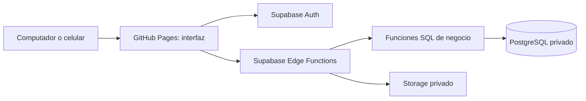

# Arquitectura vigente: GitHub Pages y Supabase

Decisión del usuario · 23 de octubre de 2026 · Sustituye la propuesta de NestJS, alojamiento adicional y pruebas publicadas.

## Ambientes elegidos

| Uso | Ubicación |
| --- | --- |
| Código, versiones, revisión y CI | GitHub: `javidez89/margaret-pos`. |
| Interfaz de producción objetivo | https://javidez89.github.io/margaret-pos/; dominio propio opcional, por definir después. Hoy la URL sirve el demo. |
| Backend de producción objetivo | Supabase: Auth, PostgreSQL, Storage, Edge Functions y funciones SQL/RPC. Proyecto todavía no creado/configurado para Margaret. |
| Desarrollo y prueba funcional | Local: http://127.0.0.1:4173, con datos sintéticos y Supabase local cuando se implemente. |
| Pruebas automáticas | Entorno efímero de GitHub Actions. No crea una URL pública de QA ni opera datos reales. |

No se contratará otro alojamiento ni se implementará NestJS para este alcance. Las ramas `develop` y `main` se conservan: son etapas de revisión/versionamiento, no dos sitios públicos. La antigua `/pruebas/` dejará de incluirse en el siguiente despliegue aprobado; no se borra almacenamiento del navegador.

## Componentes y responsabilidad

GitHub Pages entrega HTML/CSS/JavaScript; no ejecuta Node/NestJS. El backend vive en Supabase. La web realiza solicitudes HTTPS a otro origen: configurar CORS, destinos de Auth y enlaces de retorno exactos para Pages. CORS no sustituye permisos y no protege contra llamadas hechas fuera del navegador.

La interfaz podrá seguir migrándose a React/TypeScript por módulos. Organización futura: `apps/web`, `supabase/functions`, migraciones SQL y contratos compartidos; no crear `apps/api` de NestJS ni trabajador permanente en otro proveedor. Usar tareas de Supabase y procesos por lotes acotados a los límites del servicio.

## Seguridad y transacciones

- **Auth gestionado:** Supabase verifica contraseñas; alta solo por administrador/gerente autorizado. Perfil completo, usuario automático como `MPEREZ` y activación segura de un uso; no cédula como clave. El inicio por usuario requiere una función protegida contra abuso que resuelva la identidad internamente, sin publicar correos.
- **Sesión de una SPA:** el navegador necesita tokens para llamar a Supabase. No aplica la sesión opaca con cookie HttpOnly del BFF NestJS anterior. Propuesta inicial: tokens en memoria, sin persistencia en `localStorage`; recargar exige nuevo ingreso. Definir y probar renovación, cierre y MFA privilegiado antes del piloto. Las credenciales de la demostración no se migran.
- **Permisos vigentes:** JWT firmado y válido identifica al actor; las operaciones sensibles consultan cuenta activa, sesión vigente, permisos y turno actual. No decidir roles mediante `user_metadata` ni asumir que cerrar sesión invalida inmediatamente todo JWT emitido.
- **Edge Functions:** validación de entradas, control de acceso, límites de frecuencia, documentos e integraciones. Verificar identidad con mecanismos soportados por el SDK actual. Las funciones públicas de ingreso/activación son excepciones explícitas con límites; no quitar verificación globalmente.
- **PostgreSQL/RPC:** la función de venta controla autorización, turno aprobado/abierto, precios, cantidades, stock y clave de idempotencia. En una transacción guarda venta, pagos, stock, caja, recibo, auditoría y outbox. No repartir esa confirmación entre varios llamados REST independientes.
- **Reglas también en SQL:** un usuario puede invocar directamente una RPC expuesta. Esa llamada debe verificar las mismas reglas, aunque omita Edge y la interfaz. Evitar CRUD directo de tablas financieras; esquemas privados, grants mínimos, RLS y funciones revisadas. Preferir invocador; cualquier función privilegiada exige justificación y revisión específica.
- **Secretos:** solo URL/clave publicable en la web; nunca `secret`, `service_role`, conexión SQL, certificados ni claves Hash. Separar clientes administrativos de Auth y consultas de negocio. Proteger costos/nómina también por columnas y respuestas, no solo por filas.

Conservar las reglas del [modelo transaccional](diseno/MODELO-TRANSACCIONAL.md): una ficha nueva no ingresa mercancía, compra confirmada sí; cerveza con factores de 1/30; costos históricos; devolución total/parcial aprobada y reembolso separado; un solo gasto por nómina. Las rutas HTTP ilustrativas se adaptarán a Edge Functions/RPC, no a `/api` alojada en Pages.

[Seguridad de Edge Functions](https://supabase.com/docs/guides/functions/auth), [RLS](https://supabase.com/docs/guides/database/postgres/row-level-security), [sesiones Supabase](https://supabase.com/docs/guides/auth/sessions). Lo anterior es diseño pendiente de implementación, no una auditoría aprobada de una base existente.

## Pruebas, promoción y publicación

1. Desarrollar en una rama y ejecutar QA local con datos sintéticos. Supabase local debe estar separado de producción; una web en localhost conectada a la base real sigue modificando producción.
2. PR a `develop` con controles obligatorios `validate`, `security` y `qa-browser`. Al integrar, CI valida el commit de develop sin desplegar un sitio de pruebas.
3. PR `develop` → `main`: exigir la ejecución correcta de esos tres controles, del mismo commit y árbol de código; mantener SemVer y CHANGELOG.
4. Publicación manual desde main con candidato inmutable y aprobación del ambiente production. Revalidar la ejecución QA, árbol, versión y rama antes de subir solo la interfaz de producción.
5. Verificar URL/SHA-256 y conservar evidencia. El nuevo artefacto no incluye `/pruebas/`. No se cambia el sitio público por integrar un PR a develop.

La promoción deja de depender de descargar la antigua página de pruebas. Su evidencia es la ejecución de CI de develop y sus tres controles reales. La aprobación humana de publicación se conserva.

## Dominio propio

No hace falta comprarlo para desarrollar. Cuando el usuario indique el dominio: configurar DNS/Pages y HTTPS, actualizar la URL base del publicador, rutas de la interfaz, CORS y destinos permitidos de Auth. No crear un `CNAME` ficticio ni asumir que cambiar DNS configura la autenticación. Pruebas permanecerá local.

## Respaldos y límites pendientes

Los respaldos de DB de Supabase no incluyen los objetos de Storage; comprobar DB, identidades, archivos y configuración por separado. Mantener descarga controlada de copias y ensayar recuperación aislada según el [procedimiento de recuperación](operacion/RECUPERACION.md). Las copias del navegador son solo del demo.

Usar únicamente GitHub/Supabase no proporciona una copia independiente del proveedor por sí mismo: deberá acordarse descarga periódica cifrada a un medio externo y recuperación de claves. No usar repositorio ni artefactos públicos de Actions para dumps o datos privados. RPO de 5 minutos/RTO de 2 horas siguen como propuestas por presupuestar y demostrar; no comprometer esos objetivos con una copia diaria.

El plan Supabase, región y proyecto todavía no están seleccionados. La preparación local no requiere contratar NestJS ni otro hosting. Las condiciones y límites de [GitHub Pages](https://docs.github.com/en/pages/getting-started-with-github-pages/github-pages-limits) siguen aplicando, incluso con dominio propio: restringen sitios centrados en transacciones comerciales y operaciones sensibles. La elección del usuario se registra sin afirmar que haya autorización del proveedor para operar el POS; revisar esa compatibilidad antes de habilitar datos/dinero reales.

`operationalReady` sigue en false hasta implementar y verificar backend, identidad, base, recuperación y condiciones de uso. No se ha creado un proyecto Supabase, ejecutado SQL, migrado operaciones ni publicado producción en esta actualización.
