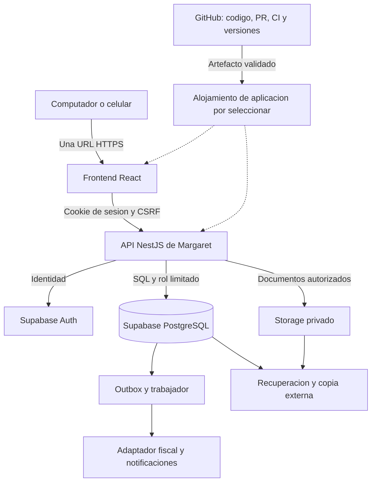

# GitHub, Supabase y API: evaluación para Margaret

23 de octubre de 2026 · Evaluación de arquitectura, sin contratación ni creación de infraestructura.

**Decisión posterior del usuario:** usar solo GitHub Pages y Supabase, con pruebas locales. La [arquitectura vigente](ARQUITECTURA-VIGENTE.md) sustituye la recomendación NestJS de este análisis. Las alternativas y precios siguientes se conservan como antecedente; los dos proyectos cloud de pruebas/producción no son un requisito vigente.

## Recomendación

**Mantener GitHub para código, versiones y automatización; usar una base PostgreSQL central gestionada. Supabase es el candidato recomendado, acompañado de la API modular de Margaret.** No se debe usar el repositorio como base de datos de ventas.

Para el alcance acordado —un local, varios cajeros, ventas en línea, acceso por URL, devoluciones autorizadas, nómina y futura integración fiscal— recomendamos conservar NestJS como dueño de los casos de uso y evaluar Supabase para PostgreSQL, Auth y Storage. Esta es una recomendación técnica pendiente de elegir proveedor y presupuesto, no una compra aprobada ni una instalación existente.

Supabase también permite una solución operativa sin NestJS, con funciones de base de datos y Edge Functions bien diseñadas. Es viable, pero traslada parte importante de la lógica y las pruebas al SQL y a esas funciones. No es suficiente conectar el demo con tablas y reemplazar cada escritura local por una llamada REST.

## Qué resuelve cada servicio

| Componente | Responsabilidad en Margaret | Lo que todavía debe construir el proyecto |
| --- | --- | --- |
| GitHub | Código, PR, migraciones, versiones, CI y entrega de artefactos. | Reglas de negocio, datos operativos e infraestructura de ejecución. Ningún token de GitHub en el navegador para guardar ventas en commits. |
| GitHub Pages | Publicación del demo estático para revisión. | No ejecuta NestJS ni aloja PostgreSQL. No será el alojamiento del POS operativo. |
| Supabase Database | PostgreSQL gestionado, restricciones y capacidad transaccional. | Esquema, índices, aislamiento, costos históricos, movimientos y estrategia de recuperación. |
| Supabase Auth | Identidades, verificación de contraseñas y mecanismos de ingreso/recuperación. | Alta gerencial, usuario `MPEREZ`, activación, permisos delegables y control del turno. |
| Supabase Storage | Almacenamiento de documentos con acceso controlado. | Buckets privados, autorización de descarga, retención y copia externa de los objetos. |
| API de Margaret | Contratos, permisos, venta/compra/devolución atómicas, caja y auditoría. | NestJS y trabajador deben desplegarse en un alojamiento compatible, por seleccionar. |
| Hosting de aplicación | URL HTTPS, frontend y ejecución de API/trabajador. | Dominio, región, configuración, disponibilidad, monitoreo y soporte. Supabase no supone un servidor NestJS contratado. |

[GitHub define Pages como alojamiento estático](https://docs.github.com/en/pages/getting-started-with-github-pages/what-is-github-pages). Sus [límites de uso](https://docs.github.com/en/pages/getting-started-with-github-pages/github-pages-limits) restringen alojar negocios centrados en transacciones comerciales y desaconsejan transacciones sensibles, como envío de contraseñas. Por ello mantenemos Pages para el demo y proponemos otro alojamiento para el programa operativo.

## Alternativas: ventajas, contras y decisión

Comparación cualitativa para Margaret; no son resultados de rendimiento ni cotizaciones.

| Alternativa | Ventajas | Contras y riesgos | Dictamen |
| --- | --- | --- | --- |
| A. Solo GitHub/Pages y almacenamiento del navegador | Aprovecha el demo y tiene poca operación de infraestructura. | Datos por dispositivo, autorización manipulable en cliente, sin transacciones compartidas ni recuperación del servidor. Guardar JSON en Git no resuelve estos problemas. | Útil para demostración; descartada para ventas reales. |
| B. GitHub + hosting web + Supabase Auth/DB/Storage + funciones SQL/Edge | Menos servicios propios; API de datos y autenticación disponibles. Puede realizar operaciones atómicas mediante funciones bien delimitadas. | RLS, privilegios de funciones, revocación y lógica SQL requieren especial cuidado. Reglas repartidas pueden dificultar pruebas y cambios. Edge tiene límites de recursos. | Alternativa válida para un MVP acotado si se acepta ese modelo de desarrollo. |
| C. GitHub + hosting web/API + NestJS + Supabase | Conserva el diseño modular; contrato único de negocio; integra datos, identidad y documentos gestionados. Mejor separación de responsabilidades para caja, nómina y fiscal. | Mayor costo y despliegue que B; añade salto de red y coordinación entre API, Auth y DB. No basta con contratar Supabase. | **Recomendada para el alcance actual.** Medir latencia y mantener la API próxima a la base. |
| D. GitHub + API + PostgreSQL gestionado de otro proveedor | PostgreSQL portable y más libertad para elegir identidad, almacenamiento y recuperación. | Más piezas que integrar; autenticación propia aumenta mantenimiento y riesgo. Precio y recuperación dependen de la oferta seleccionada. | Alternativa razonable si condiciones o costos de Supabase no encajan. No requiere cambiar el modelo de negocio. |

La API automática facilita acceso a datos, pero no conoce nuestras reglas. En PostgREST cada solicitud se ejecuta en una transacción; varias solicitudes independientes no forman una única transacción de venta. La alternativa B necesita una función/RPC que agrupe la operación; C puede usar una transacción SQL desde NestJS. [Transacciones de PostgREST](https://docs.postgrest.org/en/stable/references/transactions.html), [funciones de base de datos Supabase](https://supabase.com/docs/guides/database/functions).

Las [Edge Functions tienen límites de memoria, CPU y duración](https://supabase.com/docs/guides/functions/limits); evaluar exportaciones grandes y tareas prolongadas antes de ubicarlas allí. Un servidor o trabajador propio también necesita límites, monitoreo y mantenimiento. El [modelo de responsabilidad compartida](https://supabase.com/docs/guides/deployment/shared-responsibility-model) deja controles de aplicación a cargo del proyecto.

## Arquitectura recomendada y límites de confianza

Propuesta concreta para C:

1. Web y `/api/v1` bajo un origen HTTPS por ambiente. La web consume la API de Margaret; las operaciones financieras no escriben directamente en tablas de Supabase.
2. Mantener tablas del negocio en esquemas privados y deshabilitar la Data API si no se usa. Si después se habilita una parte, exponer explícitamente lo mínimo y probar grants, RLS y funciones. Auth, Storage y Realtime tienen sus propios controles: apagar la Data API no protege por sí solo esos servicios. [Seguridad de los canales de acceso](https://supabase.com/docs/guides/database/secure-data), [configuración de Data API](https://supabase.com/docs/guides/api/securing-your-api).
3. Conexión SQL desde el servidor con rol propio, sin superusuario, propiedad del esquema ni `BYPASSRLS`; credencial de migraciones separada. RLS como defensa adicional donde corresponda, con contexto de actor/local establecido por el servidor dentro de cada transacción. No confiar en el usuario/local que venga en el cuerpo HTTP. Separar el cliente privilegiado de administración de Auth de las consultas de negocio; no reutilizar sus privilegios para todas las ventas.
4. Empezar con refresco de datos por la API. Realtime es opcional: no garantiza stock vigente ni sustituye el bloqueo al vender. No abrir nuevos canales de acceso solo para actualizar una pantalla.
5. Trabajos, impresión y llamadas externas fuera de la transacción financiera. Outbox persistido con la venta, consumidor idempotente y conciliación antes de repetir acciones externas inciertas.

## API y base de datos: riesgos que deben bloquear la salida

| Riesgo | Impacto | Control y verificación requeridos |
| --- | --- | --- |
| Venta guardada pero stock/caja incompletos | Crítico | Una transacción inserta venta/líneas/pagos/recibo, descuenta stock y registra caja/auditoría/outbox. Inyectar fallo a mitad y comprobar rollback completo. |
| Dos cajeros venden la última unidad | Crítico | Bloquear el mismo saldo y turno en orden consistente; restricción de stock no negativo. Probar dos conexiones reales: solo una venta confirma. |
| Doble clic o respuesta perdida | Alto | Clave de idempotencia persistida, huella de petición y resultado. Reenviar la misma operación, no generar otra clave ni cobrar otra vez por incertidumbre. |
| Venta con turno revocado o usuario retirado | Crítico | Revalidar aprobación/revisión, asignación, permisos y sesión en servidor dentro del protocolo transaccional. Probar cambio simultáneo y petición directa a API. |
| API automática o RPC permite saltarse reglas | Crítico | Quitar permisos directos a tablas financieras; superficie expuesta explícita. Probar escrituras por Data API/RPC con identidad de vendedor y sin sesión. |
| Secreto de Supabase en frontend o Git | Crítico | `secret`/`service_role`, conexión SQL y claves Hash solo en servicios autorizados. Rotación y detección de secretos; nunca incluirlos en HTML, logs ni artefactos públicos. |
| RLS mal definida o insuficiente | Crítico | Denegar por defecto; políticas por operación/local/recurso. RLS filtra filas, no oculta por sí sola columnas de costo o nómina: proteger columnas/esquemas y respuestas API. |
| Permiso antiguo en JWT | Alto | No decidir solo por claims de una sesión antigua. Leer acceso vigente en operaciones sensibles; revocar sesión de aplicación y proveedor al retirar acceso. |
| Saturación de conexiones o consultas | Alto | Pool limitado, transacciones cortas, índices según consultas, paginación y límites de exportación. Probar solicitudes concurrentes y observar esperas/p95; no se ha medido capacidad. |
| Copia incompleta o restauración equivocada | Crítico | Copiar DB, objetos y configuración recuperable; destino aislado, conciliación y pruebas de integridad antes de reabrir. No restaurar directamente desde un JSON del navegador. |
| Caída de Internet/proveedor | Alto | Confirmación en línea, mensaje claro y conservación del carrito/clave. Definir conectividad de respaldo y procedimiento de contingencia; el primer alcance no incluye ventas offline. |
| Costos o dependencia del proveedor | Medio/alto | Alertas de consumo, ambientes acotados, exportación ensayada y adaptadores para Auth/Storage. No prometer migración automática solo porque PostgreSQL sea portable. |

En Supabase, las claves privilegiadas evitan RLS; una clave publicable identifica la aplicación y no sustituye la identidad/permisos del usuario. [Tipos de claves y privilegios](https://supabase.com/docs/guides/getting-started/api-keys). Para tablas expuestas, revisar RLS, vistas con contexto de invocador y permisos de ejecución de funciones; no usar `SECURITY DEFINER` para ocultar un fallo de autorización. [RLS](https://supabase.com/docs/guides/database/postgres/row-level-security).

El [changelog consultado](https://supabase.com/changelog/45329-breaking-change-tables-not-exposed-to-data-and-graphql-api-automatically) anuncia cambios en la exposición automática de tablas, con aplicación general prevista para el 30 de octubre de 2026. Inspeccionar la configuración real al provisionar; ni «public siempre expone todo» ni «la tabla no es accesible, entonces está protegida» son supuestos aceptables.

## Identidad: encajar Supabase Auth con los requisitos existentes

Si se elige Supabase Auth, será el único responsable de verificar y almacenar contraseñas. Su [documentación de seguridad](https://supabase.com/docs/guides/auth/password-security) indica bcrypt gestionado; no implementar otra tabla de hashes Argon2 en paralelo. La propuesta previa de Argon2id corresponde a la alternativa de autenticación propia.

El perfil de Margaret conserva UUID de identidad, nombres/apellidos, usuario automático, cédula, correo, celular, dirección y estado. Las cuentas `MPEREZ` se mantienen como identificador del negocio: [Auth usa correo o teléfono para contraseña](https://supabase.com/docs/guides/auth/passwords), por lo que la API resuelve internamente usuario → identidad/correo. No publicar un buscador que devuelva correos al consultar un usuario.

Modelo de sesión propuesto: la API actúa como intermediaria de autenticación y entrega a la web una sesión opaca en cookie protegida. Tokens del proveedor se mantienen y renuevan en el servidor. Esto requiere implementar gestión de sesión, expiración, CSRF y revocación; no se obtiene marcando `HttpOnly` en una integración que depende del SDK de Supabase en el navegador. La web no usará ese SDK para abrir canales directos de datos.

Los JWT emitidos pueden seguir siendo válidos hasta su vencimiento tras cerrar sesión. En operaciones sensibles comprobar vigencia real —incluida la sesión del proveedor cuando proceda— y acceso actual. No basar roles en `user_metadata` editable por el usuario. [Sesiones y revocación](https://supabase.com/docs/guides/auth/sessions), [claims y RLS](https://supabase.com/docs/guides/database/postgres/row-level-security).

El alta autorizada crea un perfil pendiente y activa mediante invitación/código seguro con vencimiento, seguido de contraseña personal. Deshabilitar registro público, definir SMTP propio y destinos de retorno permitidos; MFA para administradores/gerentes antes del piloto. La creación en Auth y del perfil mediante APIs diferentes no es una transacción SQL única: necesita estados de aprovisionamiento, reintentos seguros y conciliación, sin habilitar cuentas a medias. Probar alta simultánea, activación usada/vencida, cuenta deshabilitada y retiro con sesión abierta.

## Conexiones, versiones y portabilidad

Conectar API y base en regiones próximas y medir desde los dispositivos/redes del negocio antes de elegir. Reservar una conexión del pool para toda la transacción; usar `SET LOCAL` para contexto transaccional y evitar arrastrar identidad entre solicitudes. Elegir conexión directa, pool de sesión o pool de transacción según el alojamiento y compatibilidad del driver; verificar IPv4/IPv6 y prepared statements. [Conexiones Supabase](https://supabase.com/docs/guides/database/connecting-to-postgres).

PostgreSQL 18 era la referencia inicial de diseño. Con un servicio gestionado se elegirá una versión soportada realmente disponible en el proyecto, verificando extensiones y migraciones; no se presupone que Supabase entregue esa versión. Fijar paquetes compatibles con Node 24/TypeScript, conservar lockfile y revisar cambios del proveedor antes de actualizar.

Mantener esquema/migraciones y reglas versionadas; evitar lógica dispersa en cambios manuales del dashboard. PostgreSQL permite reducir dependencia del motor, pero trasladar Auth, sus identificadores, Storage, políticas y configuración exige un plan. El ensayo de salida debe recuperar datos, identidades y documentos en un destino separado, no solo exportar una lista de productos.

## Respaldos y costo: condiciones reales

Los backups gestionados de DB no incluyen los objetos de Storage. Además, las copias físicas no equivalen a un archivo descargable completo; para portabilidad hay que generar y comprobar una copia lógica compatible. PITR requiere como mínimo compute Small y reemplaza la rutina de copias diarias del servicio. [Alcance de los respaldos Supabase](https://supabase.com/docs/guides/platform/backups).

Para Margaret, añadir copia externa cifrada de datos y objetos/versiones, configuración recuperable y acceso a claves por separado. Reconstruir inventario/caja, verificar vouchers y conciliar acciones fiscales/pagos al restaurar. No publicar dumps como archivos del repositorio ni artefactos de Actions. El [procedimiento general](operacion/RECUPERACION.md) sigue aplicando; los pasos físicos administrados por el proveedor deben adaptarse, no asumir acceso a `pg_basebackup` o a sus archivos WAL.

RPO de 5 minutos y RTO de 2 horas siguen siendo objetivos sin demostrar. Una copia diaria no satisface ese RPO; contratar PITR tampoco prueba por sí solo la recuperación completa de documentos y procesos externos. Se requiere un simulacro medido.

Referencia de precios públicos en USD/mes al consultar; escenarios para una organización dedicada, sin otros proyectos ni consumo extra:

| Escenario Supabase | Base orientativa |
| --- | --- |
| Free para experimentación | USD 0; pausa por inactividad y sin backups automáticos incluidos. |
| Pro con un proyecto Micro | Desde USD 25. |
| Pro con dos proyectos Micro | Desde USD 35. |
| Pro: producción Small + PITR 7 días y pruebas Micro | Aproximadamente USD 140: 25 + 15 + 10 − 10 de crédito + 100. |

Son escenarios, no presupuesto contratado. Faltan hosting de web/API/trabajador, dominio, correo, copia externa, impuestos y excedentes. El crédito y costo incremental dependen de la organización y sus proyectos. [Precios oficiales](https://supabase.com/pricing), [requisitos de PITR](https://supabase.com/docs/guides/platform/backups). No confundir el add-on de dominio del servicio Supabase con comprar/alojar el dominio de la aplicación.

## Ambientes y despliegue

| Ambiente | Diseño propuesto |
| --- | --- |
| Desarrollo local | Datos sintéticos; Supabase local/DB compatible y correo de pruebas. Migraciones y tests sin credenciales de producción. |
| CI de cada PR | Base efímera para dominio/integración y pruebas de contratos. Verificar además la configuración específica de Supabase en un proyecto de pruebas antes de promover. |
| Pruebas compartidas | Proyecto separado `Margaret pruebas`, origen web y secretos propios. Free puede servir para explorar si se acepta pausa/capacidad; presupuestar un entorno estable para QA continuo. |
| Producción | Proyecto separado, plan y recuperación acordados, dominio HTTPS, secretos y archivos aislados. Promoción manual del artefacto validado y migraciones compatibles. |

Una rama Git no crea una base aislada. Una preview de base tampoco garantiza tener aislados todos los servicios/configuración; verificar el alcance concreto antes de usarla. Se recomienda empezar con proyectos separados para pruebas y producción, no inventar aislamiento por prefijos en las tablas. [Gestión de ambientes](https://supabase.com/docs/guides/deployment/managing-environments).

## Validación hecha y trabajo pendiente

- Revisados el código/dependencias, almacenamiento, permisos y control de preparación del repositorio. Continúa siendo un demo sin backend operativo ni conexión a Supabase.
- Contrastados los puntos anteriores con documentación y precios oficiales actuales; el índice Markdown de changelog no fue legible mediante el navegador de búsqueda y se revisó su versión HTML y el cambio relevante enlazado.
- La conexión de Supabase permitió listar metadatos de proyectos; no se identificó uno llamado Margaret. No se consultaron tablas/datos de otros proyectos ni se ejecutó SQL, cambios de esquema o contratación. No hay auditoría de RLS de una base de Margaret todavía.
- Validar esta decisión no significa haber medido latencia, capacidad, seguridad del despliegue o restauración PostgreSQL. Esas pruebas requieren implementar y seleccionar el proyecto de pruebas.

Siguiente entrega recomendada: una prueba técnica en ambiente aislado con alta/activación de dos cajeros, login por usuario, permisos actuales, creación de producto/compra y una venta atómica con turno aprobado. Demostrar doble envío, última unidad, revocación y restauración de DB + un documento privado. Registrar resultados y costo antes de habilitar producción.

La elección de Supabase y del alojamiento está pendiente de decisión del negocio. Para continuar desarrollo local no hace falta comprar un dominio ni activar un plan pago. Mantener el bloqueo de producción hasta cumplir los criterios de la [revisión de arquitectura](REVISION-ARQUITECTURA-BACKEND.md).
