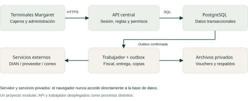
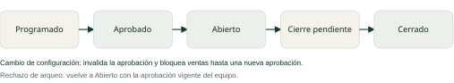
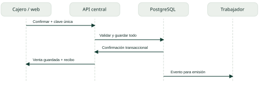

# Margaret: arquitectura, seguridad y flujo end to end

Versión 1.0 | 22 de octubre de 2026 | Colombia

Actualización del 23 de octubre: consultar la [revisión para iniciar el backend](REVISION-ARQUITECTURA-BACKEND.md), el [modelo transaccional](diseno/MODELO-TRANSACCIONAL.md) y el [procedimiento de recuperación](operacion/RECUPERACION.md). Esos documentos amplían el diseño y registran las decisiones confirmadas de un local, ventas en línea y activación segura para cuentas reales. El PDF conserva la instantánea original del día 22.

## Arquitectura de la plataforma

> Margaret necesita una aplicación web con un servidor central y una base de datos compartida. La autorización de una venta debe decidirse en el servidor, con el turno y el inventario vigentes.

Documento de diseño para dirección y equipo de desarrollo. Versión 1.0, 22 de octubre de 2026, Colombia. Describe el demo existente y una arquitectura propuesta; no implica que la infraestructura de producción esté implementada.

### Punto de partida

| Aspecto | Demo actual | Objetivo de producción |
| --- | --- | --- |
| Operación | HTML y JavaScript local; datos del navegador. | Aplicación web con API, sesiones y PostgreSQL central. |
| Vendedores | Actualización entre pestañas del mismo archivo/navegador. | Todos los terminales consultan la misma información. |
| Controles | Permisos y transacciones simulados en el cliente. | Validación y transacciones obligatorias en el servidor. |
| Comprobantes | Voucher interno, código Hash y configuración fiscal. | Documento interno y documento fiscal con estados separados. |
| Respaldos | JSON completo; copias locales con la página abierta. | Copias cifradas externas, automáticas y restauración controlada. |

### Decisiones de diseño

- Monolito modular: un backend con módulos separados y una única base transaccional. Facilita operar el primer local y conservar coherencia entre caja e inventario.
- Trabajo asíncrono para emisión fiscal, entrega de documentos, exportaciones grandes y respaldos. El mismo proyecto ejecuta API y trabajador en procesos separados.
- Ventas en línea en la primera versión. Sin conexión se bloquea la confirmación; no se presenta una venta pendiente como guardada.
- Conservar como especificación funcional el demo y migrar únicamente datos revisados; no convertir localStorage en la base de producción.

### Límite del alcance

Una empresa y un punto de venta inicial, preparado para varios terminales. Todas las operaciones incluyen empresa, local, usuario, fecha y turno cuando corresponda. Abrir nuevas sucursales requiere validar sus cajas, numeraciones, permisos y conectividad.

## Componentes y comunicación

| Componente | Responsabilidad y decisión |
| --- | --- |
| Web de Margaret | React + TypeScript; interfaz corporativa, formularios, accesibilidad y estado visible del cobro. No decide permisos ni calcula importes definitivos. [S1] |
| API central | NestJS + TypeScript; módulos de negocio, sesiones, autorización, validación y contratos HTTP documentados. Un único origen HTTPS para la web y /api reduce complejidad. [S2] |
| PostgreSQL | Fuente de verdad de ventas, caja, inventario, autorizaciones y contabilidad operativa. Restricciones, claves únicas y bloqueo de filas. [S3] |
| Trabajador + outbox | Consume eventos guardados con la transacción del negocio. Reintenta trabajos, registra errores y concilia estados externos antes de repetir una emisión. |
| Archivos privados | Almacén de objetos para comprobantes, respuestas fiscales y copias cifradas. Versionado y enlaces temporales sujetos a permiso. |
| Servicios externos | Adaptador fiscal, correo y, si se contrata, pasarela de pagos. Secretos en un gestor de claves, nunca en el navegador. |

La API y el trabajador comparten repositorio y modelos, pero usan credenciales y responsabilidades distintas. Se pueden aumentar sus instancias sin dividir prematuramente el negocio en microservicios. Los eventos de interfaz avisan que hubo cambios; el servidor vuelve a comprobar todo al recibir una operación.

> Arquitectura tecnológica propuesta, no selección de proveedor comercial. Las versiones se fijan al implementar, usando versiones soportadas y dependencias verificadas.

## Módulos y modelo de datos

| Módulo | Entidades principales y regla |
| --- | --- |
| Identidad y equipo | users, profiles, roles, permissions, role_permissions, sessions. Documento como texto; usuario único. Retirar el acceso conserva el historial. |
| Turnos y caja | shifts, shift_members, shift_approvals, shift_closures, cash_movements. La aprobación referencia una revisión exacta de la configuración. |
| Catálogo e inventario | products, product_presentations, barcodes, stock_balances, stock_movements. Código único por presentación; cantidades en unidad base. |
| Compras | suppliers, purchases, purchase_lines. La ficha de producto no ingresa mercancía; una compra confirmada sí registra inversión y entrada. |
| Ventas | sales, sale_lines, sale_payments, receipts. Precio, impuestos y costo histórico por línea; número de recibo único, no basado en contar filas. |
| Devoluciones | returns, return_lines, refund_payments. Cantidad máxima disponible por línea; aprobación separada del reembolso. |
| Gastos y nómina | expense_concepts, expenses, payroll_payments. Un pago de nómina crea un solo gasto asociado mediante referencia única. |
| Fiscal y control | fiscal_documents, fiscal_attempts, outbox_events, audit_events, backup_runs. La venta y su documento fiscal tienen estados independientes. |

### Relaciones indispensables

Empresa > local > turno > asignaciones > ventas > líneas. Cada línea identifica un producto/presentación y guarda sus valores históricos. Una devolución referencia venta y línea; un reembolso referencia una devolución aprobada. Un documento fiscal referencia la venta o su ajuste. El recibo mantiene la identidad de quien vendió aunque luego cambie su perfil.

### Reglas de persistencia

- Claves foráneas y restricciones únicas para códigos, recibos, claves de idempotencia y eventos. Eliminación lógica de maestros vinculados; movimientos confirmados se corrigen mediante eventos compensatorios.
- Dinero y costos con tipos decimales: por ejemplo, importes NUMERIC(18,2) y costo unitario NUMERIC(20,6). Definir y probar el redondeo fiscal; no usar coma flotante binaria para totales.
- Fecha/hora del servidor en UTC; fecha operativa y reportes en America/Bogota. Los valores históricos no se recalculan con los precios actuales.
- Cada cambio importante conserva actor, local, revisión, motivo y correlation_id. Las claves, tokens y datos de tarjetas no forman parte del registro de auditoría.

## Roles e ingreso seguro

| Operación | Administrador | Gerente | Vendedor |
| --- | --- | --- | --- |
| Crear, editar y retirar vendedores | Sí | Sí | No |
| Cambiar permisos de vendedores | Sí | Sí, dentro de límites | No |
| Crear administradores o ampliar privilegios gerenciales | Sí, con control reforzado | No | No |
| Aprobar turno y cambios de configuración | Sí | Sí, con permiso | No |
| Abrir/entregar caja | Sí | Sí, con permiso | Solo responsable asignado |
| Registrar venta | Con permiso y turno autorizado | Con permiso y turno autorizado | Con permiso, asignación y turno autorizado |
| Aprobar devolución / registrar reembolso | Sí | Sí, con permiso | Solo solicitar |
| Compras, gastos, nómina y reportes globales | Sí | Según permisos | Sin acceso por defecto |
| Descargar datos / solicitar recuperación | Sí | Según permiso y alcance | No |

### Alta de una persona, de extremo a extremo

Un administrador o gerente registra nombre completo, cédula, correo, celular y dirección. El servicio genera el identificador con inicial del nombre y primer apellido en mayúsculas, normaliza acentos y resuelve duplicados con un sufijo. Permite corregir apellidos compuestos antes de crear. Ejemplo: María Pérez > MPEREZ.

Se crea un acceso en estado de activación. El primer ingreso obliga a cambiar la contraseña; hasta entonces no permite vender. Tras activarse, la sesión recibe únicamente los permisos efectivos y el alcance del local. Retirar una cuenta revoca sus sesiones y mantiene ventas, cierres y nómina.

> Decisión confirmada el 23 de octubre: las cuentas reales usarán activación aleatoria, de un solo uso y con vencimiento, seguida de la creación de contraseña personal. Reemplaza el requisito anterior de cédula como clave temporal, que todavía aparece en el demo histórico. No migrar esas claves ni desplegar las cuentas de prueba con clave 1234.

Ningún gerente puede ampliar sus propios privilegios o conceder permisos que no puede delegar. Toda autorización combina rol, local, recurso y estado de la operación; ocultar un botón no sustituye este control. [S4]

## Turnos: aprobación y apertura

- 1. El gerente configura fecha, horario, responsable y mínimo dos vendedores activos. Guardar aumenta la revisión del turno.
- 2. Al aprobar, el servidor registra quién, cuándo y qué revisión exacta autorizó. Cambiar equipo, horario, responsable o nombre invalida esa aprobación.
- 3. El responsable asignado o un administrador/gerente autorizado abre la caja y registra la base inicial. La aprobación sola no permite vender.
- 4. La interfaz de cada vendedor se actualiza mediante eventos y consulta al recuperar conexión. Al cobrar, la API lee otra vez la asignación, los permisos y la aprobación.
- 5. Enviar arqueo pasa a Cierre pendiente y bloquea nuevas ventas. Otro administrador o gerente revisa el cierre; quien entrega no aprueba su propio arqueo.
- 6. Aprobar el cierre conserva el resumen del turno. El siguiente comienza Programado, sin heredar aprobación, base ni cierre.

### Condición obligatoria para confirmar una venta

> Sesión válida + usuario activo + contraseña definitiva + permiso de venta + local autorizado + turno abierto + revisión aprobada vigente + asignación del vendedor + existencias suficientes.

El servidor bloquea la misma fila del turno para confirmar una venta, cambiar su configuración o iniciar su cierre. Así una aprobación no puede revocarse a mitad de la transacción sin que una operación espere o se rechace. El cliente envía la revisión que vio; una revisión antigua obliga a actualizar la pantalla. [S3, S5]

### Horario y asignación

El demo no impone el horario del reloj. Para producción hay que decidir si la fecha y hora serán solo informativas o una restricción operativa, incluyendo turnos nocturnos y tolerancias. Si se exige esa restricción, se valida con la hora del servidor y se audita cualquier excepción gerencial.

## Venta, comprobante y cobro

- 1. El cajero escanea o elige categoría y presentación. La pantalla muestra disponibilidad y productos más vendidos; elegir medio de pago no confirma el cobro.
- 2. Al confirmar, envía cantidades, presentación, turno/revisión y una clave de idempotencia. El servidor calcula importes y costos; no acepta como verdad los totales del navegador.
- 3. En una transacción bloquea turno y saldos de productos en orden estable, valida autorización, vuelve a comprobar existencias y calcula el cambio en efectivo.
- 4. Guarda venta, líneas con costo histórico, medio/estado del pago, salida de inventario, movimiento de caja si aplica, recibo, auditoría y evento outbox. Todo se confirma junto o se revierte.
- 5. Devuelve el mismo resultado ante un reintento con la misma clave y contenido. La misma clave con otro contenido se rechaza. Un tiempo de espera no significa que la venta haya fallado: primero se consulta su estado.
- 6. El navegador muestra Compra finalizada solo después de confirmar el servidor. La impresión tiene un trabajo independiente; reimprimir no crea otra venta. El trabajador gestiona los documentos y la entrega fiscal.

### Separar dinero, venta y documento fiscal

Efectivo: el usuario confirma el dinero recibido y el servidor calcula el cambio. Transferencia o tarjeta manual: registrar referencia y confirmar la recepción según la operación. Si se integra una pasarela, su notificación verificada y su conciliación determinan el pago; no la pantalla del cajero.

Un cobro externo puede existir aunque falle la respuesta de la aplicación. Ese caso pasa a conciliación y nunca dispara un segundo cobro automáticamente. Si ya se recibió efectivo y no se pudo guardar, se debe resolver o devolver el dinero; no indicar al cajero que cobre de nuevo.

> Prueba esencial: dos cajeros intentan vender la última unidad. Solo uno confirma. El otro recibe un mensaje de stock actualizado; no hay inventario negativo ni dos recibos para la misma solicitud.

## Inventario y movimientos de dinero

### Compras y presentaciones de cerveza

Crear ficha por código o escaneo registra el producto sin existencias. Confirmar compra registra proveedor, fecha, presentación, cantidad y costo. Unidad = 1; paca = 30 unidades; canasta = 30 botellas. Cada código apunta a una presentación del producto correcto. No convertir a 30 una referencia que ya es un multipaque sin revisarla.

> Ejemplo: 2 pacas a $75.000 cada una ingresan 60 unidades y $150.000 de inversión. Costo unitario: $2.500. Si la unidad se vende a $3.500, la diferencia de precio y costo es $1.000 antes de impuestos y gastos. Vender 3 unidades descuenta 3, no 3 pacas.

Costo promedio nuevo = (existencias anteriores x costo anterior + unidades recibidas x costo recibido) / existencias finales. Se conserva la compra original y el costo de cada venta. Compra de mercancía es inversión; su costo se reconoce al vender, evitando restar la compra y el costo vendido dos veces.

### Devolución total o parcial

- Buscar venta y verificar su comprobante; elegir todas las unidades disponibles o productos/cantidades concretos. Restar devoluciones pendientes, aprobadas y ya pagadas para evitar exceder lo vendido.
- El vendedor solicita con motivo. Administrador o gerente aprueba cantidades y si la mercancía es apta para regresar al inventario. Aprobar no mueve caja ni existencias.
- Al confirmar un único reembolso, registrar efectivo o transferencia y su referencia. Si es efectivo, validar caja abierta y saldo; si es transferencia, conciliar el pago realizado.
- En la misma transacción del reembolso se suma inventario apto al costo histórico, se registra la salida de dinero y se crea el comprobante. Mercancía dañada no se repone ni revierte su costo como inventario disponible.
- Una referencia retirada se recupera de forma controlada conservando su identidad histórica. Una devolución fiscal genera el ajuste que corresponda y no modifica el documento emitido original.

### Gastos y nómina

Los gastos guardan concepto, fecha, valor, usuario y origen del dinero. Un pago de nómina vincula empleado, periodo, conceptos, deducciones, valor neto y voucher con un único gasto. Efectivo de la caja actual afecta el arqueo; pagos desde otra cuenta afectan el negocio pero no esa caja.

### Alertas y reportes

Inventario: amarillo de 5 a 9 unidades, rojo de 0 a 4. Reportes globales, diarios, quincenales, mensuales y por usuario parten de las mismas transacciones; la devolución se reconoce en la fecha del reembolso. Separar bases, impuestos recaudados y total cobrado para no presentar impuestos como ganancia.

## Facturación y periféricos

### Configuración fiscal

La interfaz conserva las opciones Factura electrónica y Factura POS. La segunda debe mapearse al documento equivalente electrónico POS. La habilitación, numeración, firma, transmisión y validación aplicables deben completarse antes de emitir documentos fiscales reales. El demo solo prepara la configuración. [S6, S7]

- Guardar la solicitud fiscal y su identificador junto a la venta. Un trabajador del adaptador genera/transmite, conserva solicitud y respuesta y entrega el documento cuando corresponda.
- Si hay rechazo, mostrar motivo y responsable de corregir. Si la respuesta es incierta, consultar al proveedor/DIAN antes de volver a emitir. Los reintentos reutilizan la identidad de la operación.
- La numeración fiscal es independiente del número interno de venta. Sus rangos no se editan para corregir ventas ni se reinician al recuperar una copia.
- Una devolución referencia el documento original y origina una nota crédito o ajuste según el documento. Las contingencias fiscales requieren su procedimiento propio; estar sin internet no convierte un voucher común en factura válida. [S7]

### Código Hash del voucher

Mantener máximo 10 caracteres alfanuméricos como alias de consulta, con restricción única y reintento ante colisión. Vincular fecha, hora, vendedor, recibo y contenido mediante una firma/HMAC completa con nonce aleatorio y clave protegida en servidor. El alias corto no es una contraseña ni constituye por sí mismo prueba de autenticidad. La consulta verifica el registro protegido; una consulta pública muestra solo información mínima. CUFE/CUDE se conservan completos, por separado.

### Impresora, cajón y lector

Preparar impresión de 58/80 mm según el equipo confirmado. El lector en modo teclado alimenta el campo de código. Imprimir no confirma que salió papel: registrar solicitado, enviado y resultado cuando el controlador lo informe. Cajón, corte automático o impresión silenciosa requieren agente local/controlador documentado. Si el equipo falla, permitir reimpresión sin repetir cobro ni salida de inventario.

## Seguridad de la plataforma

| Riesgo | Control propuesto |
| --- | --- |
| Acceso con clave conocida | Activación de un uso; MFA para roles administrativos; límites de intentos y recuperación verificada. Hash de contraseñas con Argon2id y parámetros calibrados. [S8] |
| Robo de sesión | HTTPS; cookies Secure, HttpOnly y SameSite; protección CSRF donde corresponda. Rotar sesión al autenticar; revocar al retirar acceso o cambiar privilegios. No guardar tokens de sesión en localStorage. [S9] |
| Vender sin permiso o en otro local | Denegar por defecto y validar cada solicitud/recurso en servidor. Revisar sesión, permisos, asignación y estado al confirmar; nunca confiar en IDs o roles enviados por la web. [S4, S5] |
| Manipular precios o stock | Validación estructural y de negocio; consultas parametrizadas; claves y restricciones; bloqueo de turno y saldos dentro de la transacción. [S3] |
| Inyección y datos no confiables | Escapar contenido al presentar; CSP y encabezados adecuados; evitar HTML de usuario. CSV sin fórmulas ejecutables y códigos como texto. Analizar archivos importados sin ejecutar su contenido. |
| Filtración de datos personales | Limitar campos visibles por rol; cifrado en tránsito y almacenamiento; enlaces temporales; retención y acceso definidos para datos de personas y nómina. No guardar PAN/CVV de tarjetas. |
| Alterar o borrar trazabilidad | Eventos de auditoría sin edición desde la aplicación; réplica/archivo con permisos separados y controles de integridad. Registrar cambios de permisos, aprobaciones, exportaciones y restauraciones. |
| Exposición de secretos | Gestor de secretos y separación por ambiente. Rotación de claves y certificados; no incluirlos en repositorio, logs, respuestas web ni descarga gerencial. |

### Verificación de seguridad

Usar OWASP ASVS como catálogo de requisitos comprobables; proponer un perfil equivalente a nivel 2 ajustado al alcance y documentar las excepciones. Esto es una meta de validación, no una certificación del demo. Añadir pruebas de escalada de privilegios, acceso a recursos ajenos, repetición de solicitudes y modificación del turno durante el cobro. [S10]

> Cédula, dirección, correo y nómina requieren controles de privacidad. Definir responsable, finalidad, retención y procedimiento de atención con el negocio antes de cargar datos reales. No inventar un plazo legal uniforme para todos los documentos.

## Respaldos y recuperación

### Dos clases de copia

Copia gerencial: exportación portable y cifrada con inventario, movimientos, personas, permisos y configuración, limitada al alcance autorizado. Copia operativa: recuperación de base de datos, documentos privados y referencias de identidad. Las contraseñas no se entregan en texto; los hashes de la copia operativa y la recuperación de claves tienen acceso restringido.

Objetivos iniciales propuestos: pérdida máxima de datos (RPO) de 5 minutos y recuperación del servicio (RTO) de 2 horas. Deben validarse mediante simulacros y capacidad contratada; no son capacidades demostradas por el HTML. Propuesta: recuperación puntual con WAL durante 7 días, 30 copias diarias y 12 mensuales, cifradas y con otra cuenta/ubicación de almacenamiento. PostgreSQL permite recuperación puntual con copia base y registros WAL. [S11]

### Procedimiento end to end de recuperación

- 1. Registrar el incidente y poner las escrituras en mantenimiento. Detener trabajadores que puedan emitir documentos o ejecutar pagos.
- 2. Conservar una copia del estado actual si es recuperable. Identificar fecha, versión de esquema, manifiesto y claves de recuperación de la copia elegida.
- 3. Verificar integridad y acceso; restaurar primero en un entorno aislado. Comprobar tablas, archivos, relaciones, saldos, credenciales y permisos.
- 4. Comparar conteos, sumas y contenido: compras, ventas, devoluciones, gastos, nómina, inventario y caja. Un checksum no sustituye la comprobación funcional.
- 5. Conciliar los pagos y documentos fiscales emitidos después de la copia con las fuentes externas. Una restauración local no deshace un cobro ni una factura ya emitida.
- 6. Recuperar el estado más reciente de numeración fiscal y del diario externo de emisión; impedir reutilizar números o reenviar trabajos ya ejecutados. Si falta esa evidencia, mantener la emisión bloqueada.
- 7. Autorizar el cambio al entorno recuperado. Revocar sesiones y revisar credenciales de servicio; las claves de cifrado se recuperan por un procedimiento separado.
- 8. Abrir sesiones nuevas, validar el turno vigente y habilitar gradualmente ventas y trabajadores. Conservar acta del incidente y medir el RPO/RTO real.

### Validación del demo

El demo ya descarga y carga JSON con comprobación de integridad y lectura posterior. Los archivos de evidencia registran 29 verificaciones de restauración con datos ficticios y coincidencia completa. No equivalen a un simulacro de infraestructura, recuperación fiscal ni prueba en los computadores del local.

> Una copia guardada únicamente en el mismo navegador no protege frente a pérdida del computador. El respaldo de producción debe ejecutarse aunque no haya usuarios conectados.

## Desarrollo y contratos

### Organización del código

Repositorio con apps/web, apps/api y apps/worker; packages/contracts para contratos compartidos y packages/domain para reglas que deban ser puras. Cada módulo separa controlador HTTP, casos de uso, dominio y repositorios. El frontend puede validar para ayudar al usuario, pero el backend conserva la validación obligatoria. No compartir secretos ni modelos de persistencia completos con la web.

| Contrato orientativo | Comportamiento obligatorio |
| --- | --- |
| POST /api/v1/shifts/{id}/approve | Actor autorizado, revisión esperada y equipo activo; aprobación auditada. |
| POST /api/v1/shifts/{id}/open | Aprobación vigente, responsable o gerente y base válida. |
| POST /api/v1/sales | Idempotency-Key, revisión del turno y cantidades; el servidor determina valores. |
| POST /api/v1/returns | Venta/líneas/cantidades/motivo. Sin mover dinero. |
| POST /api/v1/returns/{id}/approve | Aprueba el alcance exacto; cambiarlo invalida la aprobación. |
| POST /api/v1/returns/{id}/refund | Reembolso único, medio, referencia y estado conciliable. |
| POST /api/v1/shifts/{id}/close | Arqueo y observación; bloquea inmediatamente ventas nuevas. |
| POST /api/v1/exports y /backup-requests | Alcance autorizado, tarea trazable y descarga temporal. La restauración operativa usa un flujo administrativo separado. |

### Contratos, errores y números

- Documentar entradas/salidas con OpenAPI; validar tipos, tamaños, cantidades e identificadores. Decimales como cadenas en la API cuando sea necesario para evitar pérdida de precisión.
- Responder con códigos claros: 401 sesión inválida, 403 permiso denegado, 409 revisión o stock en conflicto, 422 datos inválidos. Añadir mensaje útil y correlation_id; no mostrar trazas internas.
- Persistir clave de idempotencia, huella de la solicitud y resultado en la misma transacción; restringir por empresa/operación y documentar su retención. No deduplicar por hora o total coincidente.
- Reintentos de trabajos con límite, espera progresiva y bandeja de revisión. Para respuestas fiscales o pagos inciertos, conciliar antes de reintentar. Sin promesas de exactamente una ejecución externa.

## Calidad, despliegue y aceptación

### Entrega continua

Separar desarrollo, pruebas y producción con datos y secretos diferentes. Proteger la rama principal y exigir revisión de cambios. La integración continua ejecuta análisis estático, tipos, pruebas de dominio, integración y seguridad de dependencias; genera una imagen inmutable. Aplicar migraciones compatibles y ensayadas, verificar salud y conservar una ruta de reversión. No ejecutar cambios destructivos de esquema sin plan de recuperación.

### Pruebas que deben bloquear una entrega

| Escenario | Resultado esperado |
| --- | --- |
| Dos terminales y una última unidad | Una venta confirmada; otra rechazada; stock nunca negativo. |
| Turno revocado o en cierre mientras se cobra | La transacción se ordena o se rechaza sin perder registros. |
| Doble clic, pérdida de respuesta y reintento | Una venta, una salida de stock, un recibo y un resultado consultable. |
| Devolución parcial repetida | No supera lo vendido; reembolso y reposición ocurren una sola vez. |
| Nómina y gasto asociado | Un pago y un solo gasto; fechas y totales coherentes. |
| Proveedor fiscal o impresora caídos | Estado visible y recuperable; sin duplicar cobro ni documento. |
| Usuario retirado o permiso revocado | Sesión revocada o acción rechazada también por API. |
| Recuperación tras falla | Saldos y documentos íntegros; conciliación externa y numeración protegidas. |

### Plan de implementación por hitos

- Hito 1: acordar RUT/responsabilidades, impuestos por producto, política de claves y horario, terminales, conectividad y permisos. Aprobar este diseño y los criterios de aceptación.
- Hito 2: implementar identidad central, turnos, catálogo, compras y venta transaccional; validar dos terminales reales con la misma base.
- Hito 3: incorporar devoluciones, gastos, nómina, reportes/exportaciones y documentos; conciliar totales contra escenarios conocidos.
- Hito 4: integrar el modo fiscal elegido, completar habilitación y probar equipo físico. Ensayar contingencias sin improvisar emisión fiscal.
- Hito 5: restauración completa, revisión de seguridad y piloto controlado. Migrar inventario inicial verificado y cuentas reales; excluir ventas ficticias.

Monitorear errores y latencia de cobro, conflictos de stock, ventas sin documento final, trabajos pendientes, rechazos fiscales y respaldos fallidos. La salida requiere responsables asignados para soporte, revisión de cierres, conciliación fiscal y recuperación; una batería de pruebas locales no sustituye ese piloto.

## Referencias y decisiones pendientes

Fuentes oficiales consultadas el 22 de octubre de 2026. Las recomendaciones de componentes, controles, flujos y objetivos operativos son propuestas para Margaret; las fuentes respaldan los mecanismos técnicos y el marco fiscal, no acreditan que ya estén implementados.

[S1] React: documentación oficial. [Consultar fuente oficial](https://react.dev/learn).

[S2] NestJS: arquitectura de módulos y servicios. [Consultar fuente oficial](https://docs.nestjs.com/).

[S3] PostgreSQL: bloqueo explícito y de filas. [Consultar fuente oficial](https://www.postgresql.org/docs/current/explicit-locking.html).

[S4] OWASP: autorización y mínimo privilegio. [Consultar fuente oficial](https://cheatsheetseries.owasp.org/cheatsheets/Authorization_Cheat_Sheet.html).

[S5] OWASP: autorización de transacciones. [Consultar fuente oficial](https://cheatsheetseries.owasp.org/cheatsheets/Transaction_Authorization_Cheat_Sheet.html).

[S6] DIAN: ser facturador electrónico. [Consultar fuente oficial](https://www.dian.gov.co/impuestos/factura-electronica/como-hacerlo/Paginas/ser-facturador-electronico.aspx).

[S7] DIAN: Resolución 227 de 2025, compilación normativa. [Consultar fuente oficial](https://normograma.dian.gov.co/dian/compilacion/docs/resolucion_dian_0227_2025.htm).

[S8] OWASP: almacenamiento de contraseñas. [Consultar fuente oficial](https://cheatsheetseries.owasp.org/cheatsheets/Password_Storage_Cheat_Sheet.html).

[S9] OWASP: gestión de sesiones. [Consultar fuente oficial](https://cheatsheetseries.owasp.org/cheatsheets/Session_Management_Cheat_Sheet.html).

[S10] OWASP: Application Security Verification Standard. [Consultar fuente oficial](https://owasp.org/projects/asvs).

[S11] PostgreSQL: archivado continuo y recuperación puntual. [Consultar fuente oficial](https://www.postgresql.org/docs/current/continuous-archiving.html).

### Evidencia local revisada

- Demo: output/Margaret-demo-administracion.html y su plantilla fuente.
- Turnos: output/Margaret-validacion-turnos.json, 29 comprobaciones con sesiones de prueba.
- Respaldos: output/Margaret-validacion-respaldos.json, 29 comprobaciones con datos ficticios.
- Guías existentes de turnos, respaldos y alcance de facturación.

### Decisiones que faltan antes de construir

Confirmar la ruta fiscal con el RUT del negocio; proveedor o implementación propia; impuestos y redondeos; restricción por horario; permisos delegables; costo/infraestructura y responsables del servicio. Validar RPO/RTO y retención con capacidad y presupuesto. La activación segura, el primer local y las ventas en línea quedaron confirmados el 23 de octubre. No se han fijado fechas de entrega ni costos comerciales sin esa definición.
