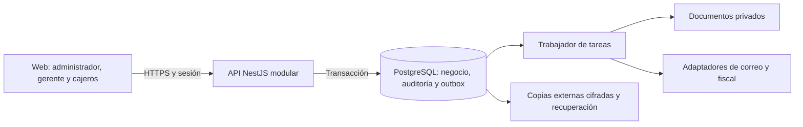

# Revisión para iniciar el backend de Margaret

23 de octubre de 2026 · Base revisada: `b26440efa8b6164c7e5e788d4b5cab9b6e75be94` · Demo 0.3.1.

**Diseño anterior:** el usuario eligió después GitHub Pages + Supabase sin NestJS ni otro alojamiento, con pruebas locales. Consultar la [arquitectura vigente](ARQUITECTURA-VIGENTE.md). Los hallazgos del demo y las reglas de negocio siguen siendo referencia; componentes, sesión BFF y publicación de pruebas de esta propuesta quedaron sustituidos.

## Dictamen y decisiones

La propuesta React + TypeScript, NestJS y PostgreSQL es adecuada para el primer local. Recomendamos mantener un **monolito modular**, con API y trabajador como procesos separados del mismo proyecto. El siguiente trabajo debe construir una primera operación completa con persistencia central; el HTML actual sigue siendo la referencia funcional y visual.

La [evaluación de GitHub, Supabase y API](DECISION-GITHUB-SUPABASE.md) amplía este diseño: recomienda GitHub para código/CI y Supabase como candidato de PostgreSQL, identidad y archivos gestionados, conservando la API de negocio. Incluye alternativas, límites de Pages, costo y riesgos; proveedor y contratación siguen pendientes. Si se elige Auth gestionado, se adapta la identidad sin mantener contraseñas propias en paralelo.

Decisiones confirmadas por el negocio en esta revisión:

- Un local, varios cajeros y conexión obligatoria para confirmar ventas.
- Plataforma web publicada en una URL HTTPS estable, accesible por Internet desde cualquier lugar mediante usuario y contraseña. Un solo local es el alcance del negocio, no una limitación a su red física.
- Para cuentas reales, sustituir la cédula como contraseña temporal por activación aleatoria, de un solo uso y con vencimiento. La cédula se conserva como dato del perfil.
- Desarrollar y validar en pruebas antes de promover a producción. Por ahora se trabaja en GitHub; no hay proveedor de alojamiento contratado.

Decisiones técnicas propuestas para implementar:

| Área | Diseño y motivo |
| --- | --- |
| Frontend | React + TypeScript por módulos; conservar marca, categorías, medios de pago horizontales y mensajes claros. Migración gradual sin copiar el objeto `db` al nuevo cliente. |
| Backend | NestJS: identidad, equipo, turnos/caja, catálogo, compras, ventas, devoluciones, gastos/nómina, reportes, documentos y operaciones. Los casos de uso controlan las transacciones. |
| Datos | PostgreSQL soportado, compatible con la versión real del proveedor elegido; la referencia inicial fue 18. SQL parametrizado y migraciones versionadas. Con `pg`, cada transacción usa una única conexión reservada del pool. Versiones exactas se fijarán al iniciar el código. |
| Comunicación | Web y `/api/v1` bajo un mismo origen HTTPS por ambiente. Identidad y permisos resueltos en servidor. No exponer PostgreSQL a los navegadores. |
| Trabajo diferido | Outbox en PostgreSQL para documentos, exportaciones y notificaciones. Trabajador independiente; no hace falta añadir Redis ni microservicios en el primer hito. |
| Archivos | Objetos privados, versionados, con descargas temporales autorizadas. Credenciales, certificados y claves fuera del repositorio. |
| Caja inicial | Propuesta: una caja compartida por turno, con responsable y al menos dos vendedores asignados. Cada venta conserva su vendedor. Confirmar este modelo antes de implementar arqueos; cajas independientes por terminal cambian el modelo. |

La recomendación del monolito y la caja inicial es una decisión de diseño para Margaret. Las fuentes oficiales respaldan los mecanismos técnicos, no certifican la aplicación. [React permite una incorporación gradual](https://react.dev/learn/add-react-to-an-existing-project); [NestJS dispone de controles de autorización](https://docs.nestjs.com/security/authorization); [node-postgres exige usar el mismo cliente durante una transacción](https://node-postgres.com/features/transactions).



Las llamadas externas se realizan después de confirmar la transacción. Una impresora caída no cancela una venta confirmada ni obliga a cobrar de nuevo. El adaptador fiscal sigue pendiente de definición y habilitación; elegir una opción en el demo no implementa emisión fiscal.

## Acceso por URL desde cualquier lugar

La plataforma operativa tendrá una dirección web estable para ingresar desde computador, tableta o celular con conexión a Internet, sin instalar el programa. El servidor y la base estarán alojados en infraestructura accesible por Internet, independientes del computador del local. Todos los dispositivos autorizados consultarán las mismas ventas, existencias, turnos y reportes de la base central.

La URL permite llegar al ingreso; cada usuario solo puede consultar o modificar lo que permitan su rol y asignación. Acceder desde fuera del local no omite aprobación/apertura de turno ni concede permiso para vender. Mantener sesiones por dispositivo, cierre de sesión y posibilidad de revocarlas; exigir autenticación reforzada a las cuentas privilegiadas según el diseño de seguridad.

| Ambiente | Dirección y comportamiento esperado |
| --- | --- |
| Demo actual | [Demo estable en GitHub Pages](https://javidez89.github.io/margaret-pos/). Se puede abrir por Internet, pero sus datos siguen siendo locales al navegador. No es todavía la plataforma central. |
| Pruebas operativas futuras | URL HTTPS propia, con origen, base, archivos y credenciales separados de producción; solo datos sintéticos. |
| Producción operativa futura | Una URL HTTPS principal para los usuarios, con la web y `/api/v1` bajo el mismo origen. Dominio y alojamiento pendientes de seleccionar; no hay todavía una dirección operativa publicada. |

Aceptación antes del piloto: ingresar con cuentas autorizadas desde dos dispositivos y redes distintas; registrar una compra o venta en uno y comprobar el dato confirmado en el otro; verificar permisos, revocación de sesión y bloqueo de venta sin turno aprobado. Validar formularios y menús en tamaños de celular y escritorio. El respaldo programado debe funcionar con el computador del local apagado. Perder conexión conserva el estado visible del cobro y exige verificar su resultado antes de reintentar con la misma clave.

## Hallazgos sobre el repositorio actual

Son brechas para pasar a operación real, no incidentes atribuidos al demo. Los enlaces identifican la evidencia examinada; las líneas corresponden al commit indicado al comienzo.

| Prioridad | Evidencia actual | Cambio necesario y aceptación |
| --- | --- | --- |
| Bloqueante: identidad y permisos | [`hasPerm`, línea 94](../src/index.template.html#L94), [`setPassword` y `verifyPassword`, líneas 100–101](../src/index.template.html#L100). El navegador conserva cuentas, hashes PBKDF2 y permisos; también hay accesos de prueba. | Sesiones y autorizaciones en API. Alterar almacenamiento o enviar un usuario distinto no concede acceso. No migrar claves, sesiones ni cuentas iniciales del demo. |
| Bloqueante: datos compartidos | [`KEY`, `db` y `persist`, línea 20](../src/index.template.html#L20); [`withShiftWrite`, líneas 290–294](../src/index.template.html#L290). La sincronización y el bloqueo son del mismo navegador/origen. | PostgreSQL y transacciones. Dos equipos compiten por la última unidad: exactamente uno confirma. Cierre y venta se ordenan sobre el mismo turno. |
| Bloqueante: respaldo operativo | [`makeBackup`, línea 182](../src/index.template.html#L182), [`startDailyBackups`, línea 335](../src/index.template.html#L335). JSON completo y tareas con la página abierta. | Programación en servidor, copia externa cifrada y restauración aislada verificada. Funciona con todos los navegadores cerrados. |
| Alta: comprobantes | [`sealVoucher`, línea 144](../src/index.template.html#L144). SHA-256 sin secreto de servidor y alias `MV` + ocho caracteres hexadecimales. | Mantener «Código Hash» de máximo 10 caracteres como identificador; guardar autenticador completo con clave de servidor y unicidad en base. Recalcular un JSON no debe permitir falsificar un comprobante. |
| Alta: mantenibilidad del frontend | [`src/index.template.html`](../src/index.template.html) mezcla HTML, interfaz, reglas, persistencia y escenario ficticio; [`package.json`](../package.json) no contiene backend ni aplicación React. | Separar vistas, cliente HTTP y contratos. El paquete operativo no debe incluir sembrado de ventas, credenciales o catálogo ficticio. |
| Alta: alcance de QA | [`tests/shift-approval.cjs`](../tests/shift-approval.cjs), [`tests/backup-roundtrip.cjs`](../tests/backup-roundtrip.cjs), [tres casos de navegador](../tests/e2e/platform.spec.mjs). | Conservar regresión del demo y añadir integración con PostgreSQL real, contratos API, dos sesiones/equipos, autorización y restauración de infraestructura. |
| Alta: aislamiento operativo | [`environments/sites.json`](../environments/sites.json) separa claves en dos rutas del mismo origen Pages. [`production.json`](../environments/production.json) mantiene producción operativa deshabilitada. | Cuando exista hosting, separar orígenes, bases, archivos, sesiones y secretos de pruebas/producción. GitHub Pages continúa sirviendo los demos. |

Se revisó `dayKey`: ya usa `America/Bogota`. No se identificó aquí un error de zona horaria; el backend deberá conservar esa regla usando la hora del servidor. Los controles actuales de PR, versión, seguridad y promoción son aprovechables; no sustituyen los controles del servidor futuro.

## Frontend: revisión y ruta de migración

Organización prevista, todavía no creada:

```text
apps/web/                 Vistas React, formularios y cliente HTTP
apps/api/                 HTTP, autorización y casos de uso por módulo
apps/worker/              Consumidor de outbox y tareas programadas
packages/contracts/       Contrato OpenAPI y tipos públicos generados
packages/domain/          Cálculos y reglas puras del servidor
database/migrations/      Migraciones SQL ordenadas, inmutables al publicarse
tests/integration/        API y PostgreSQL de pruebas
tests/e2e/                Recorridos completos de usuario
```

La interfaz no importa repositorios SQL, entidades con hashes de contraseña ni secretos. Los tipos de respuesta exponen solo los campos autorizados. Compartir tipos no convierte la validación del navegador en un control de seguridad.

Migrar primero ingreso/activación y catálogo de consulta; después turno y cobro. Cada módulo operativo usa exclusivamente la API. No permitir que una misma venta se guarde alternativamente en servidor o en `localStorage`; el demo conserva su ruta y sus datos separados. La documentación de [React respalda la migración incremental](https://react.dev/learn/add-react-to-an-existing-project), sin exigir reescribir toda la interfaz de una vez.

Estados visibles del cobro:

1. **Listo para cobrar**: turno abierto y aprobado según la última consulta; el servidor volverá a comprobarlo.
2. **Confirmando venta**: conservar carrito y clave de idempotencia; impedir otro envío desde el mismo formulario.
3. **Venta confirmada**: mostrar número y voucher devueltos por la API, luego vaciar el carrito.
4. **Confirmación por verificar**: si se pierde la respuesta, consultar por la misma clave; no mostrar rechazo ni iniciar otro cobro por defecto.
5. **Venta rechazada**: explicar la causa concreta —sin existencias, turno cerrado, aprobación modificada o sesión vencida— y conservar el carrito cuando sea seguro.

La ficha de producto mostrará precio de venta, costo vigente de referencia y ganancia estimada a quienes tengan permiso. La venta conserva su costo histórico. «Agregar producto» crea la referencia con cero existencias; «Registrar compra» ingresa mercancía una sola vez. Un escaneo solo identifica producto/presentación, sin registrar una compra automáticamente.

## Seguridad del primer backend

| Riesgo | Control propuesto | Prueba obligatoria |
| --- | --- | --- |
| Activación predecible o reutilizable | Token aleatorio de 256 bits, hash almacenado, vencimiento inicial propuesto de 24 horas; regenerar invalida el anterior. Entrega por canal verificado; no registrar token ni URL en logs. | Token usado, vencido o anterior se rechaza. Una cuenta sin activar no vende. |
| Sesión robada o vigente tras retiro | Sesión opaca en cookie `Secure`, `HttpOnly`, `SameSite`; hash del secreto en servidor, rotación y revocación. Validación CSRF y de origen para escrituras. | Retirar vendedor o cambiar su acceso invalida sesiones. No hay tokens en almacenamiento persistente del navegador. |
| Escalada de privilegios | Denegar por defecto; verificar permiso, local, recurso y estado. Gerente administra vendedores dentro de permisos delegables; no eleva su propio rol ni crea administradores. | Invocar endpoints directamente o cambiar un identificador no permite ver costos, nómina o recursos fuera del alcance. |
| Fraude o duplicación de operación | Importes calculados en servidor, idempotencia persistida, restricciones y bloqueo transaccional. No aceptar vendedor, aprobación, costo o ganancia enviados por la web como autoridad. | Doble clic, solicitudes repetidas y dos terminales no duplican stock, dinero, gasto ni voucher. |
| Fuga de datos y archivos | Respuestas mínimas por permiso, límites de exportación/importación, archivos privados, caducidad y auditoría de descargas. Excluir credenciales de exportaciones gerenciales. | Un vendedor no descarga costos, datos personales de compañeros ni backups operativos. |
| Abuso y alteración | Consultas parametrizadas, límites de cuerpo y frecuencia, CSP, salida escapada, trazabilidad sin secretos. Auditoría sin permisos de edición para la aplicación. | Inyección, enumeración de cuentas, CSV con fórmulas, HTML y archivos excesivos se rechazan o neutralizan. |

Si se implementa autenticación propia, se propone Argon2id calibrado en el servidor. Si se elige Supabase Auth, se delega el almacenamiento/verificación al proveedor conforme a su diseño; no crear otro almacén de contraseñas en paralelo. La cédula no será un secreto ni se mostrarán contraseñas al administrador. La recuperación usa tokens de un solo uso. Aplicar MFA a cuentas privilegiadas antes del piloto; definir recuperación y responsables para evitar quedar sin administrador. Estas decisiones se apoyan en [OWASP: contraseñas](https://cheatsheetseries.owasp.org/cheatsheets/Password_Storage_Cheat_Sheet.html), [sesiones](https://cheatsheetseries.owasp.org/cheatsheets/Session_Management_Cheat_Sheet.html) y [tokens de recuperación](https://cheatsheetseries.owasp.org/cheatsheets/Forgot_Password_Cheat_Sheet.html), con la adaptación gestionada explicada en la evaluación de proveedor.

El primer administrador se provisiona mediante un procedimiento restringido de instalación y activación, sin cuenta/clave pública por defecto. El login responde de forma genérica a cuenta inexistente y clave incorrecta. Confirmar el canal de entrega de activaciones antes del piloto; no se ha contratado correo ni enviado invitaciones en esta revisión.

## Datos, respaldo y condiciones de salida

El [modelo transaccional](diseno/MODELO-TRANSACCIONAL.md) concreta entidades, claves, costos, caja, idempotencia y contratos iniciales. El [procedimiento de recuperación](operacion/RECUPERACION.md) distingue descarga gerencial y recuperación completa. La restauración operativa no se autoriza usando una cuenta incluida en el archivo que se quiere cargar: exige identidad y permisos vigentes del sistema de operación.

No habilitar operaciones reales hasta verificar, como mínimo: identidad central, permisos por API, stock/caja atómicos, concurrencia entre terminales, recuperación completa ensayada, trazabilidad y tratamiento de datos personales acordado. La configuración fiscal requiere una revisión específica posterior con los datos del negocio; esta revisión no determina obligaciones tributarias.

## Orden de implementación y evidencia requerida

| Hito | Entrega revisable | Criterio para continuar |
| --- | --- | --- |
| 1. Base técnica y acceso | Estructura web/API, PostgreSQL local de pruebas, migraciones, activación, sesiones, equipo y permisos. CI con base efímera y datos sintéticos. | Crear dos cajeros con datos completos y usuario automático; activar sin reutilizar tokens; denegar escalada; retirar cuenta y revocar sesión. Restaurar una copia de la base de pruebas. |
| 2. Primera venta central | Catálogo, presentaciones de 1/30, compra, turno aprobado y abierto, venta/voucher y arqueo. | Dos clientes sobre la misma base: última unidad, doble envío, corte de respuesta, edición/revocación de turno y cierre simultáneo. Verificar dinero/stock/recibo tras cada caso. |
| 3. Conciliación del negocio | Devolución total/parcial, reembolso, gastos, nómina, reportes y exportaciones. | No devolver más de lo vendido; un solo gasto por nómina; saldos reconstruidos desde movimientos; reportes por fecha, período, vendedor y turno coinciden. |
| 4. Operación preparada | Observabilidad, backups externos, restauración, adaptación fiscal y pruebas de impresora/lector. | Simulacro medido, conciliación externa, revisión de seguridad, equipo físico y piloto aprobados. Hosting y configuración fiscal resueltos antes de operar. |

Las migraciones se prueban tanto en base vacía como sobre la versión anterior con datos sintéticos. Promover el mismo artefacto validado, con revisión de migraciones y reversión compatible; no ejecutar cambios de esquema al arrancar cada réplica. Mantener PR a `develop`, controles obligatorios y promoción manual conforme al [gobierno vigente](GOBIERNO-DESARROLLO.md). La integración continua de backend se añadirá en el hito 1; hoy los workflows validan el demo.

No bloquean el inicio local: elegir hosting/dominio ni proveedor fiscal. Sí deben resolverse antes de sus respectivos hitos: caja compartida o por terminal, restricciones horarias, permisos delegables, reglas de impuestos/redondeo, canal de activación, responsables de soporte/privacidad y presupuesto de recuperación. RPO/RTO y retención son objetivos propuestos, no compromisos ya disponibles.

## Verificación realizada en esta revisión

- `npm test`: correcto, incluidas 29 comprobaciones de restauración, 29 de turnos y casos de devoluciones, exportaciones, ambientes y promoción.
- `npm run check:security`: correcto. Escaneo básico de secretos y automatizaciones; no es auditoría de un servidor implementado.
- `node scripts/production-readiness.mjs --report`: confirma backend, identidad, base compartida y restauración operativa pendientes; producción continúa deshabilitada.
- No se ejecutó una restauración PostgreSQL ni una prueba entre computadores reales: aún no existe ese backend. Las tres pruebas de navegador actuales son del demo; su ejecución en CI queda asociada al PR de esta revisión.

Este informe es el diseño de inicio. No modifica ventas, inventario ni usuarios guardados en navegadores y no publica una nueva versión estable del demo.
